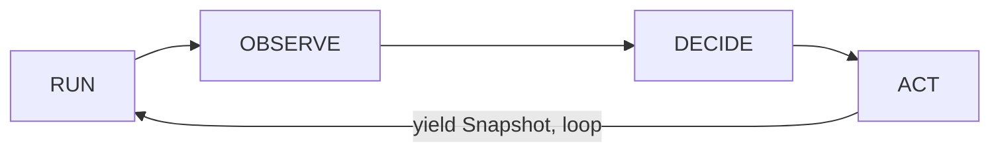
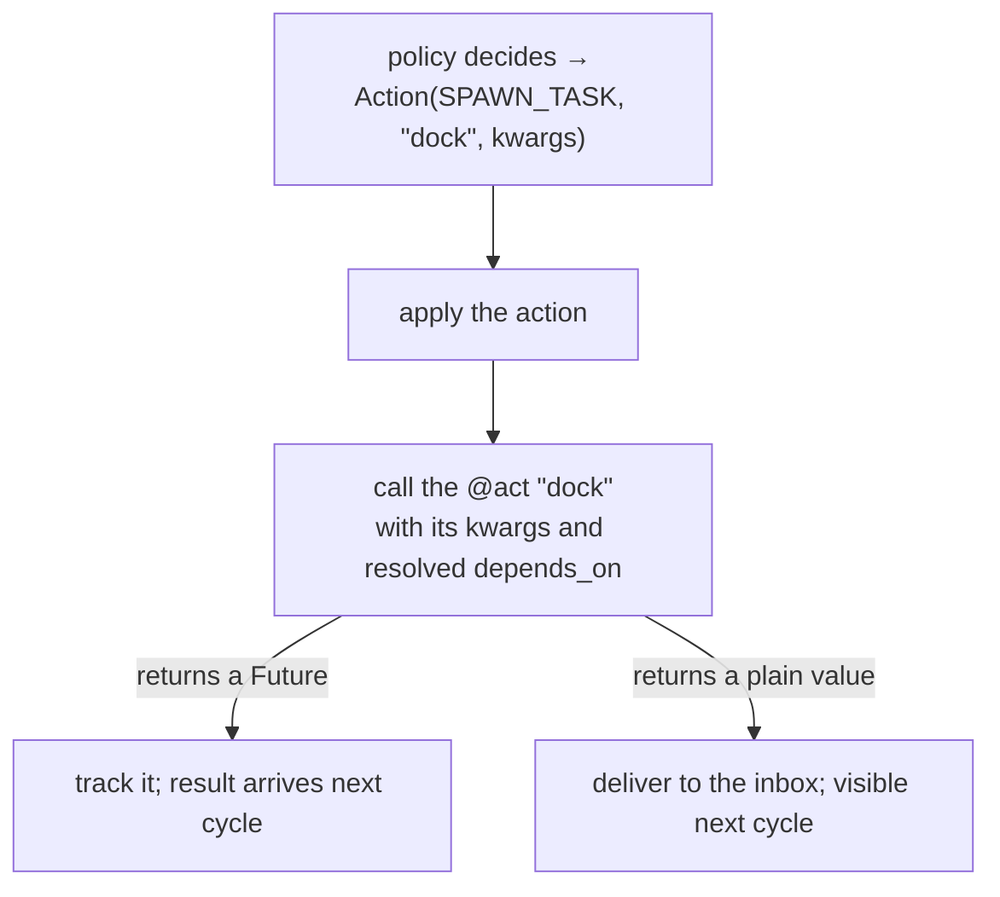

`op.run()` is an async generator. Each iteration is one **Run → Observe → Decide → Act** cycle,
ending in a yielded `Snapshot`. Understanding the order — and especially the *latency* — is what
separates a policy that works from one that double-spawns.



## RUN — drain the inbox

The inbox is the operator's **only input channel**. At the start of each cycle the operator drains
everything waiting there — task completions, child snapshots, parent directives — and refreshes the
status of tasks that have begun running (`PENDING → RUNNING`).

Messages that arrive:

| MessageKind | From | Becomes |
|---|---|---|
| `TASK_EVENT` | AsyncFlow / local act | `state.runtime[uid]`, plus `result.{uid}` or `error.{uid}` |
| `SNAPSHOT` | a child operator | mirrored child observations & metrics |
| `DIRECTIVE` | the parent operator | `state.directives` |
| `STOP` | system | ends the loop |

## OBSERVE — assemble metrics

The operator calls your `@observe(snapshot)` method, which returns a plain `dict`. This is the
**single assembly point for all metrics** — task results, operator state, or external telemetry.
The policy and the goals see *only* this dict.

## DECIDE — choose actions, then check goals

Two things happen, in order:

1. `policy.decide(obs)` returns a `Decision` (actions, goal proposals, `stop`, delegations).
2. **Goal check.** All `static_goals + runtime_goals` are evaluated against `obs`. If they are all
   satisfied, `decision.stop` is forced to `True`.

```python
all_goals = static_goals + runtime_goals
if all_goals and all(g.satisfied(obs, snapshot) for g in all_goals):
    decision.stop = True
```

<Note>
**Goals check before ACT, but the stop cycle still acts.** The goal check fires after DECIDE and
before ACT. Any actions the policy returned in the stopping cycle are still applied before the
operator exits — stopping does not discard the final batch.
</Note>

## ACT — apply the decision

Each `Action` is applied independently of *how* it executes: the operator calls the named `@act`
method, inspects what it returns, and routes accordingly.



## The one-cycle latency

This is the rule that governs policy design: **a task dispatched in cycle N produces a result in
cycle N+1.**

- An async task's result is delivered to the inbox when it completes — picked up next cycle.
- A local act's return value is delivered to the inbox the same way — same one-cycle latency.

So `@observe` in cycle N sees results from work dispatched in cycle N−1. A policy that assumes its
own freshly-spawned task is already done will misfire — gate on observed state instead (e.g.
`child.started`, or the presence of a `result.{uid}` key).

## What persists across cycles

After each cycle, per-cycle namespaces are cleared and persistent ones carry forward:

| Cleared each cycle | Persists |
|---|---|
| `observations`, `directives` | `runtime`, `objectives`, `artifacts`, `task_context` |

See [State & Snapshots](/concepts/state-and-snapshots) for the full model.

## Next

<CardGroup cols={2}>
  <Card title="State & Snapshots" icon="database" href="/concepts/state-and-snapshots">
    The namespaces, their lifetimes, and the frozen Snapshot.
  </Card>
  <Card title="Decisions & Actions" icon="list-check" href="/concepts/decisions-and-actions">
    Everything a policy can return.
  </Card>
</CardGroup>
