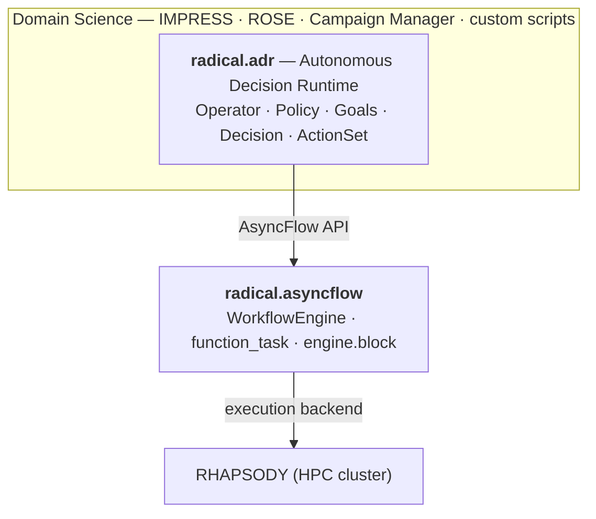
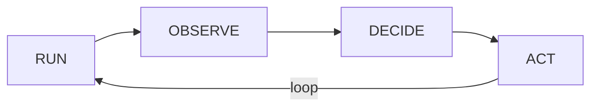

Before you write an operator, hold three things in your head: **where ADR sits**, **the loop it
runs**, and **the boundary it refuses to cross**. Everything else in these docs is detail on top
of these three ideas.

## Where ADR sits

ADR is a *steering* layer. It sits above the execution engine and below your domain science.

- **Your domain science** defines *what the workflow is trying to achieve* — the metrics, the
  candidates, the convergence criteria.
- **ADR** decides *what to run next* based on partial results, and *when to stop*.
- **AsyncFlow** turns those decisions into distributed execution on an HPC backend.

## The adaptive cycle

An `Operator` runs one loop, forever, until its goals are met:

| Step | What happens |
|------|-------------|
| **RUN** | Drain the inbox: task completions, child snapshots, parent directives. Promote `PENDING → RUNNING`. |
| **OBSERVE** | Call your `@observe(snapshot)` method → a plain `dict` of domain metrics. |
| **DECIDE** | Call `policy.decide(obs)` → a `Decision`. Then check all goals; if every goal is satisfied, force `stop=True`. |
| **ACT** | Apply each `Action`: run `@act` methods, cancel futures, update state, spawn/cancel children. |

After each cycle the operator yields a `Snapshot`. Per-cycle data (`observations`, `directives`)
is cleared; persistent state (`runtime`, `objectives`, `artifacts`) carries forward.

<Note>
**Results are always one cycle late.** When `@act` dispatches a task, its result is *not* available
in the same cycle — it lands in the inbox and surfaces in the *next* cycle's `@observe`. Designing
for this one-cycle latency is the single most important habit when writing policies. See
[The cycle](/concepts/the-cycle).
</Note>

## The sacred boundary

This is the rule that defines ADR. The operator **only Set Goals, Observes, Decides, and Acts.** It never
owns scheduling, execution lifecycle, or distributed resources.

| ADR **only** | ADR **never** |
|---|---|
| Observes — `@observe` assembles metrics from any source | Schedules work onto nodes |
| Decides — `policy.decide` returns a `Decision` | Manages task execution lifecycle |
| Acts — calls `@act`, cancels futures, updates state | Resolves dependencies or owns resources |

Even the verbs that *look* like control — `spawn_operator`, `cancel_operator`, `cancel_task` — are
steering, not running: they delegate to `child.start(*futures)` and `future.cancel()`. AsyncFlow
owns workflow execution; RHAPSODY own task execution. ADR decides; the layers below
run.

Why it matters: keeping ADR on the steering side of this line is what lets the same operator code
run against a laptop `ThreadPoolExecutor` or a full HPC pilot without change — the execution layer
is swappable because ADR never reached into it.

## Next

<CardGroup cols={2}>
  <Card title="The Operator" icon="robot" href="/concepts/operator">
    The class you subclass to define a campaign.
  </Card>
  <Card title="The cycle, in depth" icon="arrows-rotate" href="/concepts/the-cycle">
    Inbox draining, one-cycle latency, goal checking.
  </Card>
</CardGroup>
