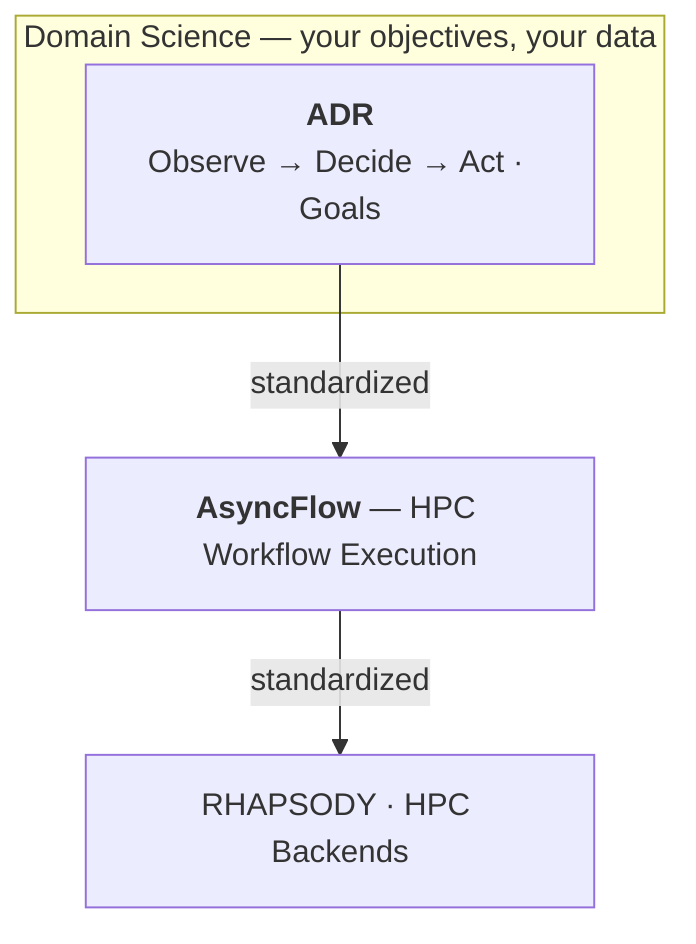

## What is ADR?

Adaptive HPC scientific workflows — protein design, active learning, materials screening — all share the same steering loop: submit work to a cluster, observe partial results, decide what to run next, repeat until the science converges. Every project reimplements this from scratch, differently, incompatibly.

**ADR does more than standardize that loop.** It provides a principled runtime for the entire adaptive steering capability:

- **A standard cycle.** An `Operator` runs an **Observe → Decide → Act** loop over long-running HPC tasks — tasks that take minutes to hours, not milliseconds.
- **Goal management.** Goals are first-class objects: set them statically, propose new ones at runtime, tighten or relax thresholds as the workflow runs. The operator evaluates all active goals every cycle and stops autonomously when they are all satisfied — scientific convergence and computational resource bounds alike.
- **Computational awareness.** ADR is designed for HPC environments. `Goal` is source-agnostic — the same abstraction tracks GPU utilization, memory pressure, or queue depth alongside scientific metrics. Resource metrics are surfaced via `@observe` from any external subscription. The steering runtime knows both what the science needs and what the infrastructure allows.

It sits above [AsyncFlow](https://github.com/radical-cybertools/radical.asyncflow) (which handles distributed execution on HPC backends) and below your domain science (which defines what the workflow is trying to achieve).

<Note>
**The sacred boundary.** The Operator only **Observes, Decides, and Acts**. It never owns
scheduling, execution lifecycle, or distributed resources — AsyncFlow owns workflow execution,
RHAPSODY owns task execution. Everything in ADR is *steering*, never *running*. See
[Mental Model](/get-started/mental-model).
</Note>

---

## Start here

<CardGroup cols={2}>
  <Card title="Install" icon="download" href="/get-started/installation">
    Add `radical.adr` to your environment.
  </Card>
  <Card title="Quickstart" icon="rocket" href="/get-started/quickstart">
    Build an adaptive-search operator end to end in three steps.
  </Card>
  <Card title="Mental model" icon="brain" href="/get-started/mental-model">
    The stack, the cycle, and the boundary ADR never crosses.
  </Card>
  <Card title="Core concepts" icon="layer-group" href="/concepts/operator">
    Operator, decorators, state, decisions, goals, policies.
  </Card>
</CardGroup>

---

## Core concepts at a glance

| Concept | Role |
|---------|------|
| [`Operator`](/concepts/operator) | The autonomous agent. Owns state, drives the cycle, stops when goals are met. |
| [`@act`](/concepts/decorators) | An action the operator can take. Return a plain value → runs locally. Return a `Future` → dispatched to AsyncFlow. |
| [`@observe`](/concepts/decorators) | Extracts domain metrics from task results each cycle. Receives the current `Snapshot`, returns a plain `dict`. |
| [`@goals`](/concepts/goals) | Convergence criteria. The operator stops automatically when **all** goals are satisfied. |
| [`Policy` / `@decide`](/concepts/policies) | Decision logic. Receives the observation dict, returns a `Decision`. Swap it without touching the operator. |
| [`Decision`](/concepts/decisions-and-actions) | What to do this cycle: spawn tasks, cancel tasks, update state, spawn/restart/cancel child operators, or stop. |
| [Built-in actions](/concepts/built-in-actions) | The fixed verb set every operator exposes (`spawn_task`, `spawn_operator`, `update_param`, `stop`, …) — each explained one by one. |

---

## Where to go next

<CardGroup cols={2}>
  <Card title="Guides" icon="map" href="/guides/adaptive-search">
    Task-oriented walkthroughs, one per runnable example.
  </Card>
  <Card title="Hierarchical operators" icon="sitemap" href="/guides/hierarchical-operators">
    Adaptive fan-out: a parent spawns a runtime-decided set of children.
  </Card>
  <Card title="LLM as policy" icon="robot" href="/guides/llm-policies">
    Swap the decision logic for an LLM that reasons in natural language.
  </Card>
  <Card title="Reference" icon="book" href="/reference/api-operator">
    API lookup and design invariants.
  </Card>
</CardGroup>
