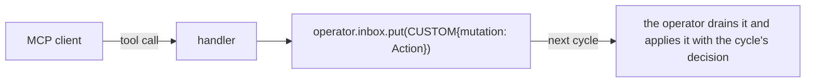

`ADLMCPServer` exposes an operator's actions over the [Model Context Protocol](https://modelcontextprotocol.io),
so an external MCP client (an IDE assistant, an agent runtime) can steer a running operator. It is a
thin transport adapter — it reuses the **same** `ActionSet` and tool schemas that LLM policies get
from `operator.get_schema(...)`, with no duplication.

<Note>
Optional dependency: `pip install "radical.adr[mcp]"` (requires the `mcp` package, 1.x — mcp 2.0
removed the `FastMCP` API this server uses). Constructing `ADLMCPServer` without it raises a clear
`ImportError`.
</Note>

## Serving an operator

The server and the operator share one event loop (the server queues onto the operator's inbox), so
run them together:

```python
import asyncio
from radical.adr.mcp.server import ADLMCPServer

server = ADLMCPServer(operator)
await asyncio.gather(
    operator.run_to_completion(),
    server.serve(transport="stdio"),   # or transport="sse"
)
```

| Constructor arg | Meaning |
|---|---|
| `operator` | The `Operator` to expose. |
| `tools` | An `ActionSet`; defaults to `operator.get_actions()`. |
| `name` | Server display name (default `"ADR Workflow Operator"`). |

Each tool in `get_schema(...)` — the built-ins (`spawn_task`, `cancel_task`, `retry_task`,
`update_param`, the operator lifecycle verbs, `stop`) plus one per `@act` — is registered with
`FastMCP` under the same name, description and parameters the LLM policies see, including the
`Tunable` bounds in `update_param`'s description.

## How a tool call reaches the operator

The server never mutates the operator directly. When a client calls a tool, the handler builds the
`Action` with the operator's `ActionSet`, checks it against the operator's action validation, and
**places it on the operator's inbox** as a `CUSTOM` message:



The handler returns `{"status": "queued", "tool": ...}` immediately. On its next cycle the operator
appends the action after the policy's own actions in that cycle's `Decision`, so it goes through the
same path as every other action:

- **Validation** — an action that is invalid when the tool is called (an unknown task, a missing
  parameter, an unknown uid) is refused with `{"status": "error", "detail": ...}` and never queued.
  It is checked again when applied; if the state changed meanwhile, it is logged and dropped. If
  applying it fails (for example the `@act` raises on an argument it cannot handle), the failure is
  logged and only that action is dropped. An external client cannot end the run this way.
- **Adaptation boundary** — `update_param` is gated by the operator's `Tunable` declarations; an
  out-of-bounds write is rejected and surfaced as evidence, as for a policy's write.
- **Action IDs and observers** — with `track_action_ids=True` the action gets an `action_id`, and
  observers (for example `RecordingObserver`) see it in that cycle's `Decision`.
- **Cadence** — external actions apply even on cycles that `decide_when` skips.
- **Stop** — the `stop` tool stops the operator after the current cycle, like a `STOP` message.

This keeps the [sacred boundary](/get-started/mental-model#the-sacred-boundary) intact — external
input arrives through the **one input channel** (the inbox), never as an out-of-band state mutation.

## Relationship to LLM policies

| | Where the model lives | How actions are applied |
|---|---|---|
| [LLM policy](/guides/llm-policies) | *Inside* the operator, as `@decide` | Directly, as the cycle's `Decision` |
| MCP server | *Outside*, any MCP client | Queued on the inbox, then applied with the next cycle's `Decision` |

Use a policy when the model *is* the steering loop; use the MCP server when an external tool needs to
nudge an operator that is already running its own loop.

## Next

<CardGroup cols={2}>
  <Card title="LLM policies" icon="robot" href="/guides/llm-policies">
    The in-loop alternative.
  </Card>
  <Card title="The cycle" icon="arrows-rotate" href="/concepts/the-cycle">
    How inbox messages are drained and applied.
  </Card>
</CardGroup>
