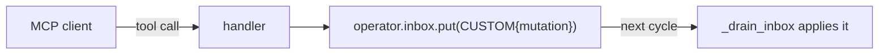

`ADLMCPServer` exposes an operator's tools over the [Model Context Protocol](https://modelcontextprotocol.io),
so an external MCP client (an IDE assistant, an agent runtime) can steer a running operator. It is a
thin transport adapter — it reuses the **same** tool registry and Pydantic schemas that `LLMPolicy`
uses, with no duplication.

<Note>
Optional dependency: `pip install radical-adl[mcp]` (requires the `mcp` package). Importing
`ADLMCPServer` without it raises a clear `ImportError`.
</Note>

## Serving an operator

```python
from radical.adr.mcp.server import ADLMCPServer

server = ADLMCPServer(operator)
await server.serve(transport="stdio")   # or transport="sse"
```

| Constructor arg | Meaning |
|---|---|
| `operator` | The `Operator` to expose. |
| `tools` | A `ToolRegistry`; defaults to `ASYNCFLOW_TOOLS`. |
| `name` | Server display name (default `"ADR Workflow Operator"`). |

Each tool in the registry is registered with `FastMCP`, named and described from the tool's own
metadata — the same schema source the LLM policies render.

## How a tool call reaches the operator

The server never mutates the operator directly. When a client calls a tool, the handler parses it
into a mutation and **places it on the operator's inbox** as a `CUSTOM` message:



The handler returns `{"status": "queued", "tool": ...}` immediately; the operator picks the mutation
up on its next cycle. This keeps the [sacred boundary](/get-started/mental-model#the-sacred-boundary)
intact — external input arrives through the **one input channel** (the inbox), never as an
out-of-band state mutation. A failing tool call is caught, logged via `log.exception`, and returned
as `{"status": "error", "detail": ...}`.

## Relationship to LLM policies

| | Where the model lives | How actions are applied |
|---|---|---|
| [LLM policy](/guides/llm-policies) | *Inside* the operator, as `@decide` | Directly, as the cycle's `Decision` |
| MCP server | *Outside*, any MCP client | Queued on the inbox as a `CUSTOM` mutation |

Use a policy when the model *is* the steering loop; use the MCP server when an external tool needs to
nudge an operator that is already running its own loop.

## Next

<CardGroup cols={2}>
  <Card title="LLM policies" icon="robot" href="/guides/llm-policies">
    The in-loop alternative.
  </Card>
  <Card title="The cycle" icon="arrows-rotate" href="/concepts/the-cycle">
    How inbox messages are drained and applied.
  </Card>
</CardGroup>
