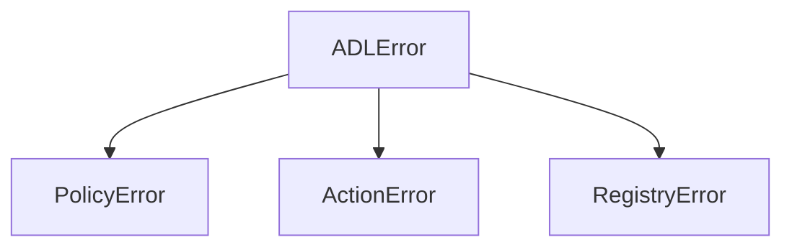

All ADR exceptions derive from `ADLError`, imported from `radical.adr`.

| Exception | Raised when |
|---|---|
| `ADLError` | Base class for all `radical.adr` errors. Catch this to handle any ADR failure. |
| `PolicyError` | A policy produces an invalid or unexecutable `Decision` — e.g. an empty `Policy` with no `@decide` and no composition called for the first time. |
| `ActionError` | An `Action` cannot be applied — unknown task/child name, missing future, or any problem found during pre-flight validation. |
| `RegistryError` | A tool or task registry lookup fails. |

## Pre-flight validation

Actions are validated **as a batch before any are applied**. A single invalid action raises one
`ActionError` listing every problem and aborts the whole batch — so an invalid action never leaves
earlier actions in the same `Decision` partially applied. See
[Decisions & Actions](/concepts/decisions-and-actions#pre-flight-validation).

## Related non-error signals

Some anomalies are **not** exceptions by design — they are logged warnings:

- `spawn_operator` on an already-started child → a `WARNING` no-op (not an error).
- `cancel_operator` on a child that never started → a `WARNING` no-op.
- A `Goal` whose metric is missing → a one-time `UserWarning`, and the goal returns `False`.

See [Logging & observability](/guides/logging-and-observability).

## See also

- [api-policy](/reference/api-policy) — `PolicyError` ·
  [api-decision](/reference/api-decision) — `ActionError`
