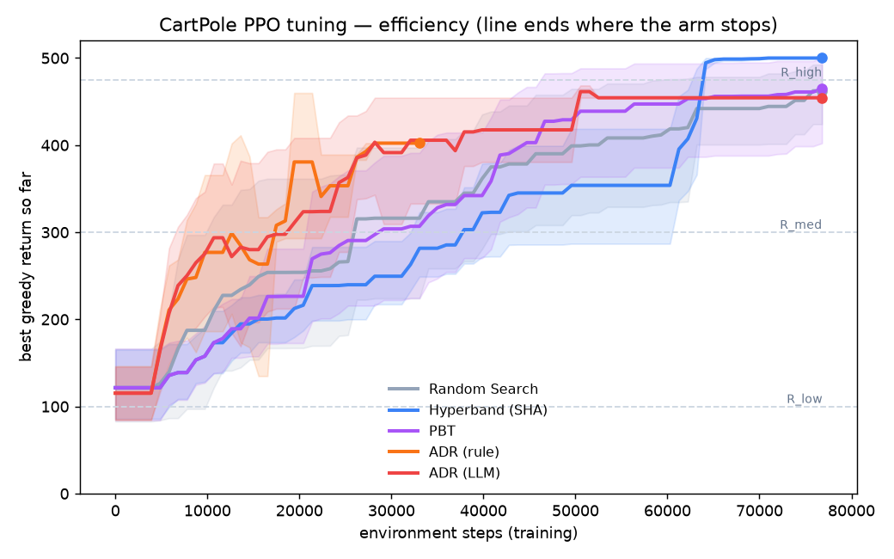
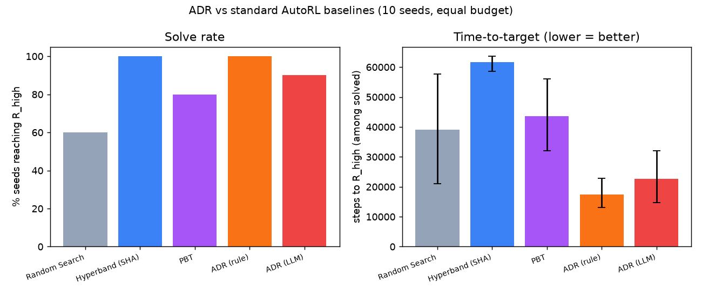
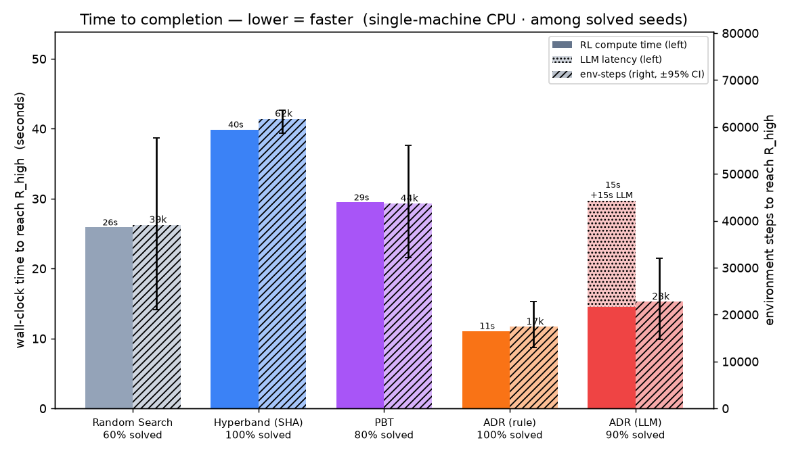

# ADR vs. standard AutoRL baselines — tuning PPO on CartPole

A **short, controlled, statistically honest** study of whether ADR's autonomous steering tunes a real
RL algorithm more efficiently than the *field-standard* AutoRL baselines — **with and without an LLM** —
and, more importantly, what it offers that they cannot.

**Hypothesis (frozen before running):** *On PPO / CartPole-v1 under an identical environment-step
budget, ADR reaches pre-registered return thresholds in comparable-or-fewer environment steps than
Random Search, Hyperband, and PBT, at comparable final return — and does so by reasoning over training
diagnostics the baselines never see.*

This is also a real-world exercise of the ADR adaptation-boundary layer: `Tunable`, `Budget`,
`decide_when`, and `trend`/`stalled` — used here exactly as shipped, with **zero ADR core changes**.

## Why this design (grounded in the literature)

ADR is **not a new RL algorithm** — it is an autonomous *tuning/steering* layer, so the relevant domain
standard is the **AutoRL / hyperparameter-optimization** literature, whose current benchmark is
**[ARLBench (Becktepe et al., 2024/2026)](https://arxiv.org/abs/2409.18827)**. ARLBench fixes the
conventions this study adopts: algorithm **PPO** (not REINFORCE); env **CartPole** (its quickstart);
baselines **Random Search / Hyperband / PBT**. Methodology follows
**[Patterson et al., 2024 — *Empirical Design in RL*](https://arxiv.org/abs/2402.03046)** (budget in
env-steps, pre-registered targets, confidence intervals over seeds, raw per-seed data). The LLM arm
follows the **[AgentHPO](https://arxiv.org/abs/2402.01881)** direction (LLM as hyperparameter
optimizer). See `reference_results/` for the immutable provenance.

## What ADR offers over the baselines  ★

The claim is **not** "ADR is a faster optimizer." Random Search / Hyperband / PBT are strong, specialized
search algorithms. ADR is different **in kind**:

1. **Mechanism-aware (white-box) decisions vs. outcome-only (black-box).** The baselines see a run as a
   scalar score (Random/Hyperband) or a ranking (PBT). ADR's `@observe` surfaces the **full PPO training
   state each trial** — KL, entropy, clip-fraction, value loss, explained variance, grad norm, trend,
   stall — and the policy decides on **why** a run is failing (tiny KL + low return = *learning too
   slowly* → raise lr; high KL/clip = *unstable update* → lower lr; persistently stuck → *jump* to a
   fresh config), not merely **that** it scored low.
2. **A general steering substrate, not a fixed heuristic** — early stopping (`Budget`/`stalled`) and
   exploit/explore are expressible as policies, with `Tunable` bounds and a hard `Budget` as built-in
   safety rails.
3. **Reasoning / knowledge injection (the LLM arm)** — the LLM injects RL expertise instead of
   statistics-over-scores or random perturbation.
4. **Auditable, bounded autonomy** — every decision is logged with its evidence and rationale; the
   `Tunable` boundary rejects out-of-range proposals (surfaced as evidence); it self-stops on the goal.

**Honest non-claim:** ADR is not a mathematically superior optimizer. The result below holds in a
**limited-budget regime** (deliberately chosen so config quality matters — with unlimited budget even
random search eventually solves CartPole). The meaningful finding is that, at equal budget, ADR's
diagnostic-driven adaptation reaches the target far more reliably and with fewer steps.

## The arms (all identical PPO primitive, search space, budget, seeds)

| Arm | Strategy | Sees |
|---|---|---|
| `random` | Random Search | final score |
| `hyperband` | Successive Halving (multi-fidelity, early stopping) | score at each rung |
| `pbt` | Population-Based Training (exploit weights + perturb config) | population ranking |
| `adr_rule` | ADR, deterministic rule policy | **full training diagnostics** |
| `adr_llm` | ADR, LLM policy (reasons over the same diagnostics) | **full training diagnostics** |

Everything shared: `cartpole_ppo.train_and_eval` (from-scratch PPO, incremental + checkpoint-threaded),
the `Tunable` search space (learning_rate, clip_coef, gae_lambda, entropy_coef, n_epochs, num_steps), a
fixed **environment-step budget**, and **10 seeds**. Only the *config-selection strategy* differs.

## Results (10 seeds, equal budget)

Budget = 76,800 training env-steps/seed (5× median-solve); 95% bootstrap CIs over 10 seeds.

| Arm | Solve rate | Steps to R_high (mean [95% CI]) | Best return |
|---|---|---|---|
| Random Search | 60% | 39,105 [20,996–57,691] | 462 |
| Hyperband (SHA) | 100% | 61,734 [58,637–63,604] | 500 |
| PBT | 80% | 43,653 [32,103–56,136] | 469 |
| **ADR (rule)** | **100%** | **17,385 [13,051–22,795]** | 495 |

**ADR reaches the target ~2.3–3.5× faster than every baseline** (its steps-to-target CI does not overlap
Hyperband's or PBT's), while matching the best solve rate — by steering on the training diagnostics
rather than the score alone.





In `fig_curves.png` each line **ends where that arm stops** (ADR self-stops at the target, so its
orange line terminates early — it does not spend the full budget). `fig_solvetime.png` shows wall-clock
seconds to reach R_high (lower = faster). ADR is fastest on env-steps, wall-clock, and solve rate.

The decision traces (`experiment_results/adr_rule.jsonl`, field `decision`) show the mechanism-aware
adaptation firing — e.g. a low-lr start diagnosed as "learning too slowly (KL≈0)" and accelerated, or a
persistently stuck lineage abandoned via a jump — which is exactly what the outcome-only baselines
cannot do.

## Install & run

```bash
pip install -r requirements.txt        # gymnasium, torch, numpy, matplotlib (+openai/instructor for the LLM arm)

python cartpole_ppo.py --reference     # confirm PPO learns; FREEZE experiment_results/targets.json
python baselines.py --arm random   --seeds 10
python baselines.py --arm hyperband --seeds 10
python baselines.py --arm pbt       --seeds 10
python main.py --arm rule --seeds 10   # ADR, no LLM, no key

export OPENROUTER_API_KEY=...           # LLM arm only
python main.py --arm llm --dry-agent   # plumbing check, no key
python main.py --arm llm --seeds 10     # ADR + LLM

python analyze.py                       # decomposition table + figures + summary.json
```

Two files, two datasets, never mixed: `reference_results/` (immutable facts from the papers) vs
`experiment_results/` (raw per-seed measurements). The final report cites: **conventions/baselines =
ARLBench; methodology = Patterson; wall-clock baseline = our local Random/Hyperband/PBT; treatment =
ADR.**

## Honest caveats

- **Limited-budget regime** (5× median-solve): chosen so adaptation matters; disclosed, not hidden.
- **ADR self-stops** at the target (efficiency), so the headline metrics are the early-stop-fair ones —
  **solve rate** and **steps-to-target among solved** — not final return.
- **Baselines are standard but simple** implementations (single-machine, small population/bracket), not
  the most heavily engineered variants; PBT in particular is budget-hungry and underperforms on a tight
  single-machine budget (a known property).
- Reproducible: `torch.set_num_threads(1)` + RNG state in the checkpoint make every arm bit-identical on
  a fixed seed across processes.
